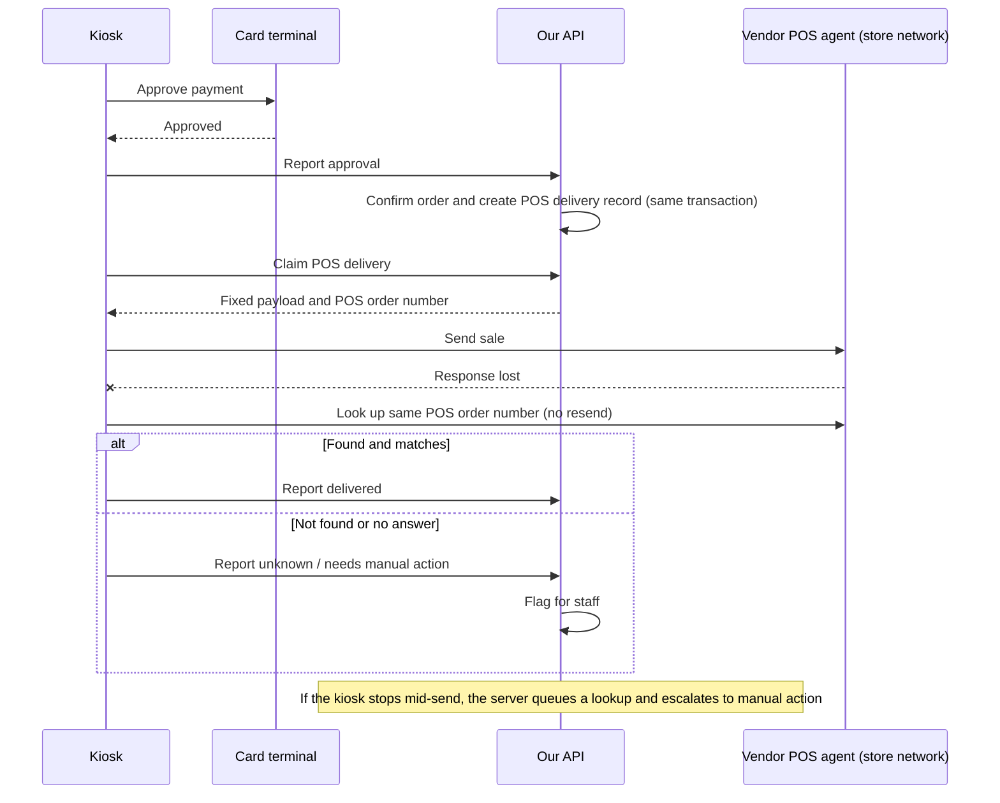

# 02. Approval and POS sale are separate facts

**System:** unattended Windows kiosks and a shared API for a theme park in Korea; kiosks in merchant shops also record their sales in a vendor's POS
**Stack:** Flutter (Windows), NestJS, Prisma, card terminal, cash device, vendor POS agent

## Problem

Merchant shops in the park use a vendor's POS. Card sales at our self-order kiosks in those shops were confirmed in our system but never reached the POS, so they were missing from POS sales and no kitchen ticket printed.

A kiosk sale therefore involves two outside systems: the card approval, then the POS sale record. The POS agent runs on the store's local network, so our cloud API cannot call it; the kiosk has to. The agent defined no HTTP status, timeout or retry contract, so when its response was lost we could not tell whether the sale had been recorded.

## Decision

Treat card approval and POS completion as two separate facts.

- A lost or unclear POS response is resolved by a lookup of the same POS order number and, if that does not settle it, by manual action. The paid order is never re-approved or cancelled because the POS step failed.
- One POS rejection, caused by our old option-quantity format, can be recovered by staff as a sales-only record: same order number, no new charge, no receipt and no kitchen print. It applies only when the stored request matches the old format exactly.
- Later, 12 older orders held up by a time bug were resumed by simply releasing them, and they re-sent their kitchen prints. Since then, recovering old orders is sales-only by default, and reprints need an explicit request.
- On the admission kiosks, cash refunds stop the ticket QR first, wait for staff to hand the cash back, then finalize on the server with the same request ID.
- Remote payouts and automatic cash refunds are not allowed. A device never fixes money on its own.

## How I got there

I based the integration contract on the vendor's API documentation. Later, a discount cancellation sent from a vendor POS failed. I correlated our API logs with a read-only database check and found the POS was sending a cancellation ID that did not match the original scan. I wrote up what the POS client should send, made a matching fix on our side, and added five regression tests for repeated scan-and-cancel cycles.

## Trade-off

More cases end in manual action instead of an automatic retry. That costs staff time, but a duplicate sale, a duplicate charge or a silent refund costs more.
