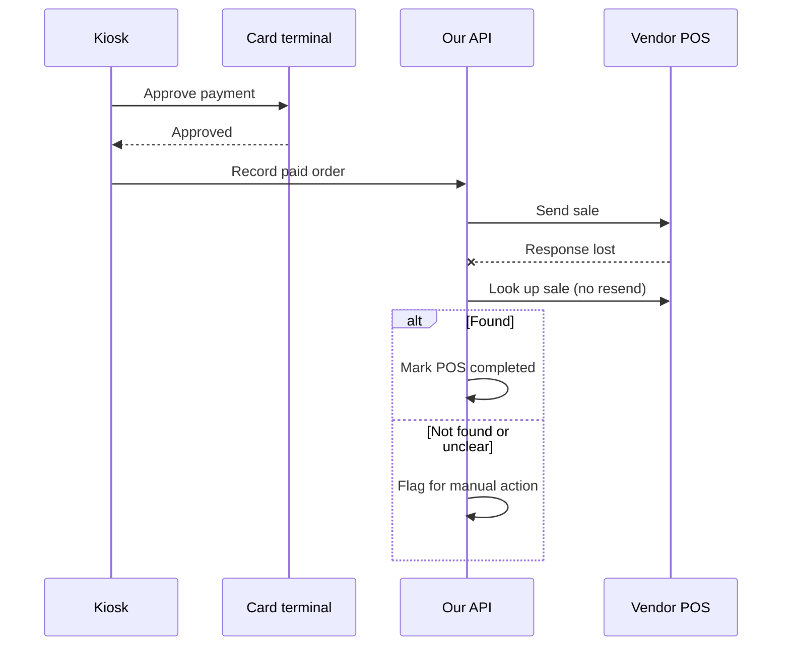

# 02. Approval and POS sale are separate facts

**System:** unattended Windows kiosks and a shared API for a theme park, sending sales to a vendor's POS
**Stack:** Flutter (Windows), NestJS, Prisma, card terminal, cash device, vendor POS API

## Problem

The client wanted admission bundles with merchant discounts that work both at our kiosks and at the vendor's POS terminals. A kiosk sale involves two outside systems: the card approval, then the POS sale record. The vendor's POS agent offered no status or retry contract, so when its response was lost, we could not tell whether the sale had been recorded.

## Decision

Treat card approval and POS completion as two separate facts.

- A lost or unclear POS response is resolved by lookup and, if needed, manual action. The paid order is never re-approved or cancelled because the POS step failed.
- One rejection type that I verified with the vendor (an option-quantity rule) is recovered as a sales-only record, with no new charge, no receipt and no kitchen print. I narrowed it to that single case after resumed orders re-sent kitchen prints.
- Cash refunds stop the ticket QR first, wait for staff to hand the cash back, then finalize on the server with the same request ID.
- Remote payouts and automatic cash refunds are not allowed. A device never fixes money on its own.

## How I got there

I aligned the integration spec with the vendor from their API documentation before writing code. When a cancellation failed later, I correlated our API logs with a read-only database check, traced it to a mismatched transaction ID, documented the handoff for the vendor and added five regression tests.

## Trade-off

More cases end in manual action instead of an automatic retry. That costs staff time, but a duplicate charge or a silent refund costs more.
